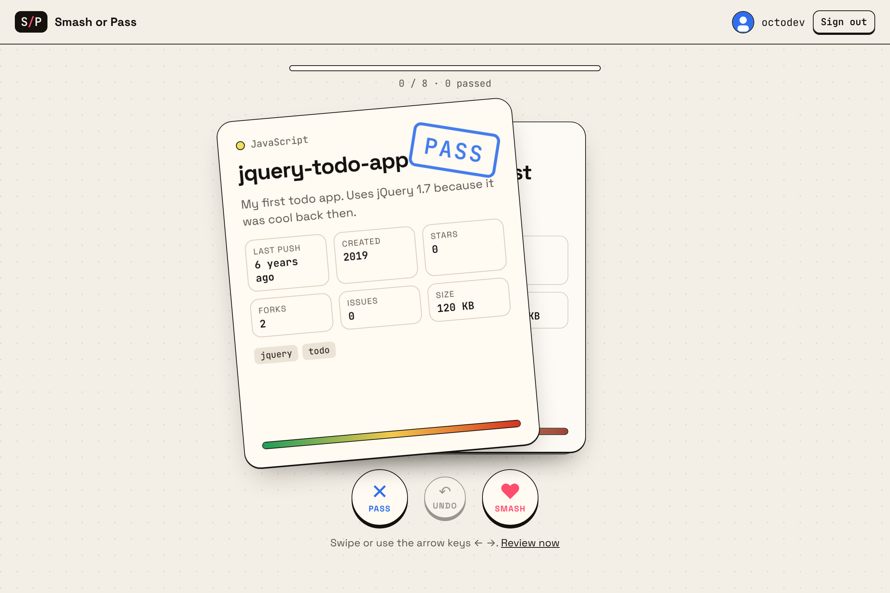
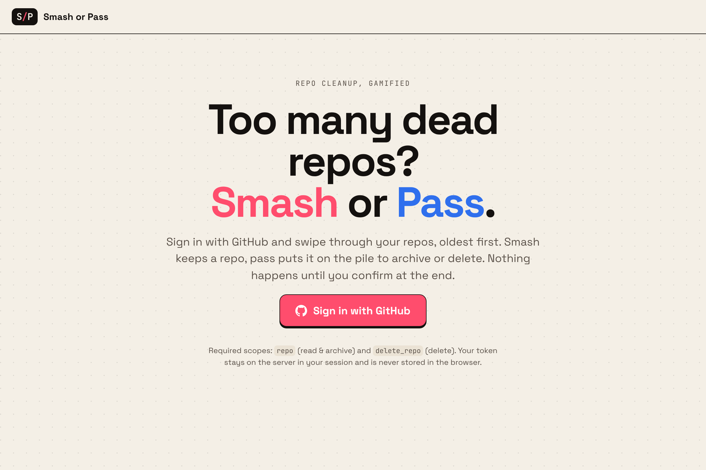
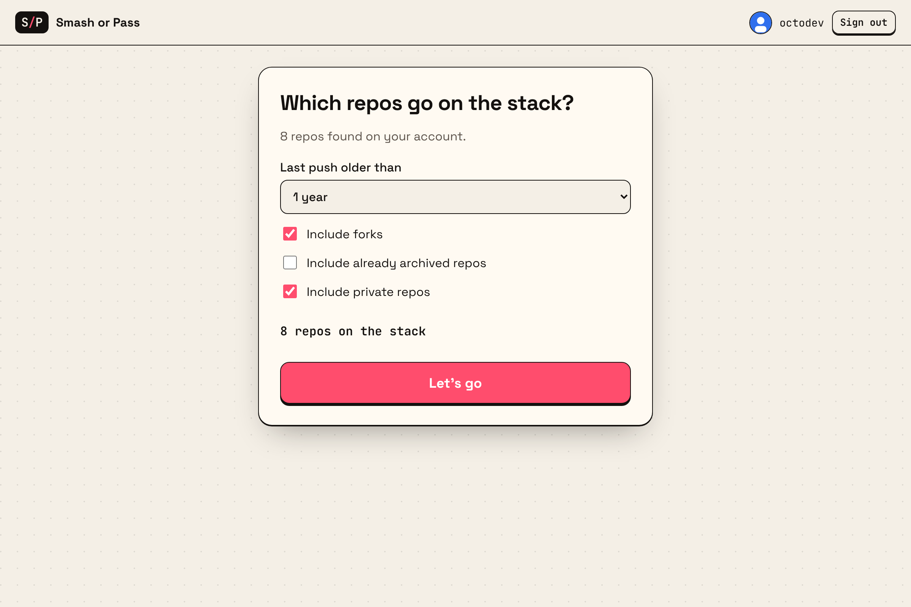
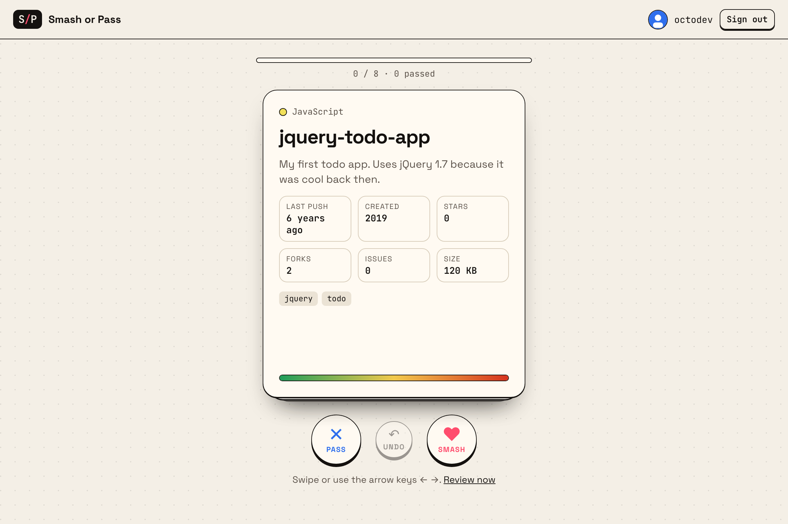
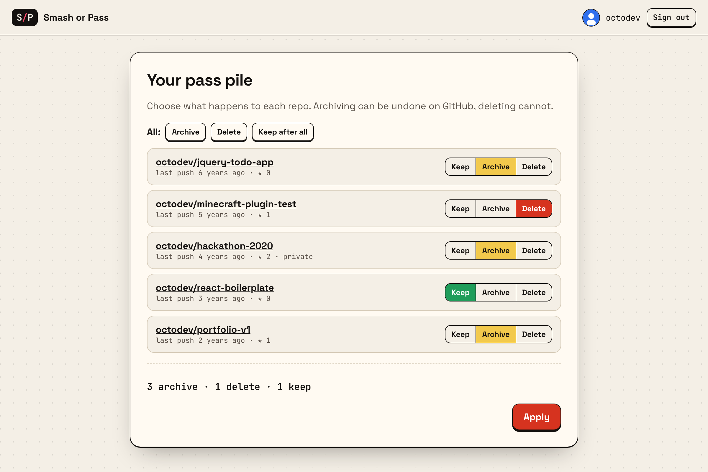
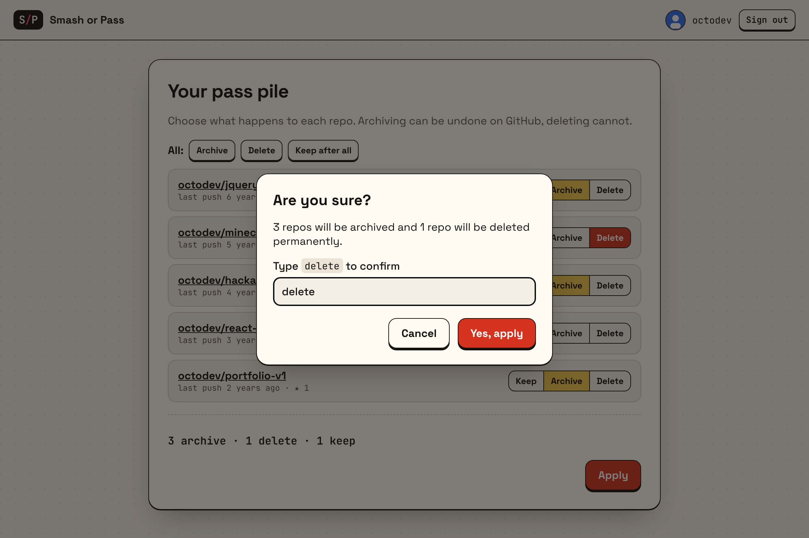
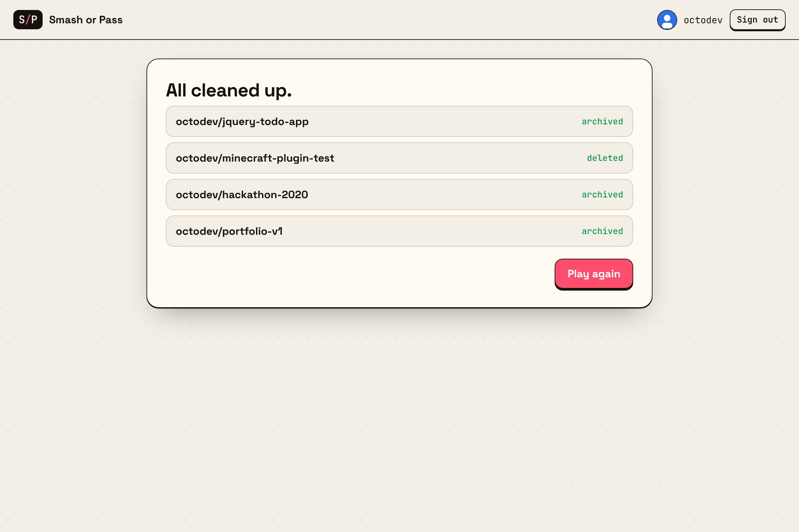
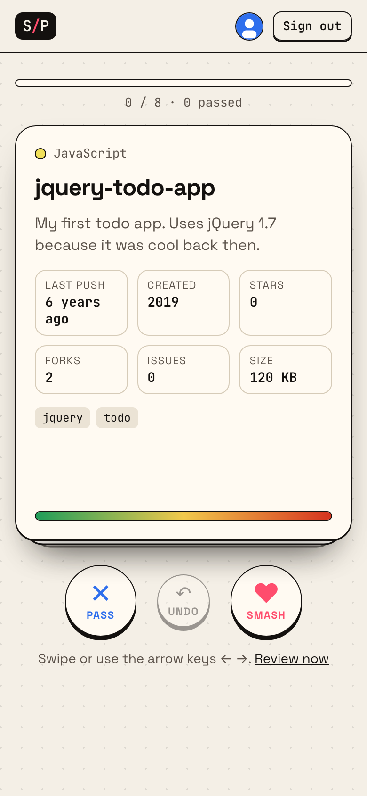

<div align="center">

# Smash or Pass 💘🗑️

**Your GitHub, decluttered. One swipe at a time.**

Sign in with GitHub, swipe through your oldest repos and decide:
**Smash** to keep it, **Pass** to archive or delete it.



</div>

---

## Why?

Everyone has them: the todo app from 2017, the hackathon project that never got a second commit, the fork you forgot about.
Cleaning them up through the GitHub settings page is tedious, one repo and five clicks at a time.
Smash or Pass turns that chore into a quick game.

## Features

- 🔐 **GitHub OAuth login.** No personal access tokens to copy around.
- 🃏 **Tinder style swiping** with mouse, touch or arrow keys (`←` pass, `→` smash, `Backspace` undo).
- 🧓 **Oldest first.** Repos are sorted by their last push, with an age meter on every card.
- 🎛️ **Filters** for last push age, forks, private repos and already archived repos.
- 🗂️ **Review before anything happens.** Every passed repo can be set to *keep*, *archive* or *delete*, individually or in bulk.
- 🛑 **Safe by default.** Passed repos default to *archive* (reversible). Deleting requires typing `delete` to confirm.
- 📱 **Responsive**, works on phones, and supports dark mode.
- 🪶 **Zero dependencies.** Plain Node.js server and vanilla JS frontend.
- 🐳 **Docker ready**, one click deploy on Coolify.

## Screenshots

| Sign in | Pick your stack |
| --- | --- |
|  |  |

| Swipe | Review |
| --- | --- |
|  |  |

| Confirm | Done | Mobile |
| --- | --- | --- |
|  |  |  |

## Quick start

### 1. Create a GitHub OAuth App

Go to **[GitHub → Settings → Developer settings → OAuth Apps → New OAuth App](https://github.com/settings/applications/new)** and fill in:

| Field | Value |
| --- | --- |
| Application name | `Smash or Pass` (or anything you like) |
| Homepage URL | `http://localhost:3000` |
| Authorization callback URL | `http://localhost:3000/auth/callback` |

Copy the **Client ID** and generate a **Client secret**.

### 2. Configure and run

Requires **Node.js 20.12 or newer**.

```bash
git clone https://github.com/TinyBrickBoy/SmashOrPass.git
```

```bash
cd SmashOrPass
```

```bash
cp .env.example .env
```

Put your Client ID and secret into `.env`, then start the server:

```bash
npm start
```

Open <http://localhost:3000> and start swiping.

### Configuration

| Variable | Required | Default | Description |
| --- | --- | --- | --- |
| `GITHUB_CLIENT_ID` | yes | | Client ID of your OAuth App |
| `GITHUB_CLIENT_SECRET` | yes | | Client secret of your OAuth App |
| `BASE_URL` | no | `http://localhost:PORT` | Public URL of the site, without trailing slash. Must match the callback URL of the OAuth App. Use `https://` in production (enables `Secure` cookies and HSTS). |
| `PORT` | no | `3000` | Port the server listens on |

## How it works

```
Browser ──► /auth/login ──► github.com (authorize) ──► /auth/callback
                                                            │
                                         token is stored server side in the session
                                                            │
Browser ◄── /api/repos  ◄── GitHub REST API (your own repos, oldest push first)
Browser ──► /api/repos/:owner/:repo/archive   (PATCH archived: true)
Browser ──► DELETE /api/repos/:owner/:repo     (DELETE repository)
```

| Path | Purpose |
| --- | --- |
| `server.js` | HTTP server, OAuth flow, sessions, GitHub API proxy, static files |
| `public/index.html` | All screens of the app |
| `public/app.js` | Swipe logic, filters, review and execution |
| `public/style.css` | Styling incl. dark mode |

### OAuth scopes

| Scope | Why |
| --- | --- |
| `repo` | List private repos and archive repos |
| `delete_repo` | Delete repos you chose to delete |
| `read:user` | Show your name and avatar |

Only repos **owned by you** are listed and can be changed. Organization repos are never touched.

## Security

Deleting repos is serious, so the app is built defensively:

- The OAuth token **never reaches the browser**. It lives in a server side session referenced by a random `HttpOnly`, `SameSite=Lax` cookie (`Secure` on HTTPS).
- The OAuth `state` parameter protects the login flow against CSRF, and the session id is **rotated after login** to prevent session fixation.
- Every mutating request requires a custom `X-Requested-With` header and a matching `Origin`, so other sites cannot trigger archive or delete calls.
- The server only allows archive and delete for repos whose owner is the signed in user.
- On sign out the token is **revoked on GitHub**, not just forgotten.
- Strict security headers: Content Security Policy without inline scripts, `frame-ancestors 'none'`, `X-Frame-Options: DENY`, `nosniff`, `no-referrer` and HSTS on HTTPS.
- All repo data is rendered with `textContent`, never as HTML.
- Nothing is changed on GitHub until you confirm in the final dialog, and deletions need an extra typed confirmation.

Found a vulnerability? Please read [SECURITY.md](SECURITY.md) and report it privately instead of opening a public issue.

## Deploy with Docker / Coolify

The repo ships a small `Dockerfile` (Node 22 Alpine, runs as non root user, built in healthcheck on `/healthz`).

### Coolify

1. **Create a GitHub OAuth App** like in the quick start, but with your real domain:
   - Homepage URL: `https://smash.example.com`
   - Authorization callback URL: `https://smash.example.com/auth/callback`
2. In Coolify: **New Resource → Public/Private Repository**, pick this repo and choose **Dockerfile** as build pack.
3. Set **Ports Exposes** to `3000` and add your domain (`https://smash.example.com`).
4. Add the **environment variables**:

   | Variable | Value |
   | --- | --- |
   | `GITHUB_CLIENT_ID` | your Client ID |
   | `GITHUB_CLIENT_SECRET` | your Client secret (mark it as secret) |
   | `BASE_URL` | `https://smash.example.com` |

5. **Deploy.** Coolify picks up the healthcheck from the Dockerfile automatically.

> `BASE_URL` must exactly match the domain in your browser and in the OAuth App, otherwise login and the CSRF origin check fail.

### Plain Docker

```bash
docker build -t smash-or-pass .
```

```bash
docker run -d -p 3000:3000 -e GITHUB_CLIENT_ID=... -e GITHUB_CLIENT_SECRET=... -e BASE_URL=http://localhost:3000 smash-or-pass
```

### Deployment notes

- Sessions are kept **in memory**. Restarting the server (or redeploying the container) signs everyone out, and running several instances needs sticky sessions or a shared store.
- Always run behind **HTTPS** in production and set `BASE_URL` to the `https://` URL.
- Sessions expire after 8 hours of inactivity.

## Contributing

Pull requests are welcome! Ideas for what could come next:

- Star count and recent activity based "smash suggestions"
- Transfer a repo to an organization instead of deleting it
- Bulk make private instead of archive
- Persistent session store (Redis, SQLite)

Please keep the project dependency free where reasonable.

## License

[MIT](LICENSE)
